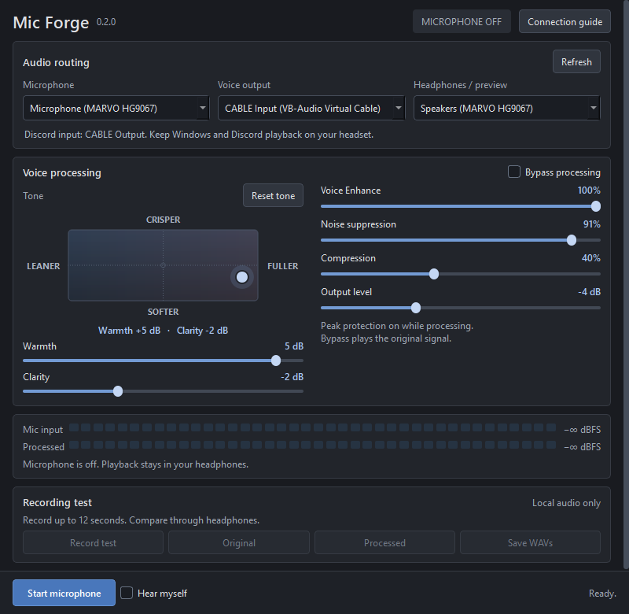

# Mic Forge

A compact, local microphone processor for Windows. **Version 0.2.0**.



[Download the Windows release](https://github.com/akiprofi09-boop/Mic-Forge/releases/latest) | [Validation and benchmarks](VALIDATION.md)

RNNoise suppression, voice enhancement, a two-axis tone pad, compression and peak protection. Audio stays on your PC. No account, telemetry or cloud processing.

## Run and connect

1. Download the Windows x64 ZIP from Releases, extract it, and open **Mic Forge.exe**. Keep the whole folder together. The executable is unsigned. Opening it normally leaves the microphone off.
2. Install [VB-CABLE from VB-Audio](https://vb-audio.com/Cable/) separately if you want to use processed audio in Discord or a game. Restart Windows if its installer requests it.
3. Choose your **physical microphone**, **CABLE Input** as voice output, and your **headphones** for previews.
4. In Discord or the game, choose **CABLE Output** as microphone input. Keep Windows and Discord playback on your headset. Do not set CABLE Input as default speakers.
5. Click **Start microphone**. Minimize to keep processing in the tray. Closing the app or choosing Quit stops processing.

Without VB-CABLE, choose **Local test only** to record and compare. The app does not install drivers or change Windows audio defaults. Physical microphones must support the app's 48 kHz mono WASAPI input; compatibility depends on the device and driver. Virtual inputs, Stereo Mix and desktop loopback are excluded.

For an explicitly configured startup shortcut, append `--start-microphone`. This starts only when both a physical microphone and a cable output are available. Headphone monitoring always starts off. Settings from earlier versions remain compatible.

Discord screen sharing with system audio can include the virtual cable playback and duplicate your voice. Share the application you need with application-only audio when available, or disable share audio. Noise suppression cannot remove a second copy caused by capture routing.

## Controls

- **Tone pad:** drag right for fuller lows, left for a leaner voice, up for crisper speech, or down for a softer tone. It controls the existing Warmth (180 Hz) and Clarity (3.2 kHz) trims from -6 to +6 dB; the sliders and pad stay linked. Arrow keys adjust either axis by 1 dB. **Reset tone**, Home, or a double-click centers both trims at 0 dB while preserving Voice Enhance and the other controls. Your saved tone loads without changing it. This is an independently designed EQ interface, with no added pitch shifting, reverb, audio-processing stages, or background timers. Adjust the pad and click **Processed** to compare the same saved recording with the new tone.
- **Minimize to tray:** minimizing hides the window in the Windows notification area while microphone processing continues. Click the tray icon or choose **Open Mic Forge** to restore it. **Quit Mic Forge** in the tray menu or the window's close button stops processing and exits. If no system tray is available, minimizing keeps the normal taskbar behavior.
- **Voice Enhance:** combines a stronger low-voice shelf, a reduction in muddy mids, clearer speech presence, a light high-frequency lift and compression. Higher settings preserve more of the low voice range. It adds weight while preserving your natural pitch. Zero removes its contribution; the separate controls still apply. Noise suppression remains independent.
- **Noise suppression:** blends RNNoise with a delay-aligned original signal. High amounts remove more steady noise but can affect voice texture. It is not acoustic echo cancellation.
- **Warmth / Clarity:** fine EQ adjustments in addition to Voice Enhance. A high-pass removes low rumble while processing; its cutoff moves from 75 Hz to 55 Hz as Voice Enhance increases.
- **Compression:** reduces loud/quiet variation, with modest makeup gain. It can make background noise more noticeable.
- **Output level:** level before the limiter. The limiter uses a soft knee and a -1 dBFS sample ceiling while processing. It cannot repair clipping that already happened inside the headset or Windows input.
- **Bypass:** original signal, with a fixed 20 ms alignment delay matching the bundled RNNoise library. Bypass skips suppression, EQ, gain, compression and peak protection.
- **Hear myself:** optional delayed headphone monitoring. Use headphones; speaker monitoring can feed back. This starts off.
- **Record test:** stores up to 12 seconds of original and processed mono audio **in memory**. Finish early with the same button. Original plays the untouched recording; Processed applies your **current controls** to that same original each time you click it. You can adjust sliders and compare without re-recording. Changing controls stops an active preview; click Processed again to hear the changes. Both previews use the same playback gain. Playback stops the microphone to avoid sending test audio into a call. Click Start microphone to resume afterward.
- **Save WAVs:** applies the current controls, then exports the processed WAV you choose and a matching ` - original.wav` file, at 48 kHz / 16-bit mono. Nothing is written until you choose to save.

For a fair comparison, use the same phrase and listen for clarity and noise, not just loudness. For a fuller, crisper starting sound, try Voice Enhance at 60%, suppression at 80%, Warmth and Clarity at 0 dB, Compression at 35%, and Output level at 0 dB. These are starting values, not a measured HG9067 calibration. Compare 0% and 100% Voice Enhance on the same recording to hear its range, then choose a comfortable amount. Added low end can sound boomy on some voices; reduce Voice Enhance or Warmth if needed.

## If other people hear PC audio

Mic Forge has no desktop capture or desktop mixing path. This prevents one common routing mistake, but cannot guarantee that the physical mic contains no music. Headphone leakage, headset crosstalk, driver effects, another program writing to CABLE Input, or app-specific audio settings can still cause it.

Record an **original** test while remaining silent and playing music. If music is in the original recording, it was already present in the selected microphone signal. Compare with earcup volume reduced to zero to help diagnose acoustic leakage. Do not expect compression or noise suppression to reliably remove music under speech.

## Build from source

Use Python 3.12 x64 on Windows 10/11. PowerShell, from this folder:

```powershell
python -m venv .venv
.\.venv\Scripts\python.exe bootstrap.py
.\.venv\Scripts\python.exe -m unittest test_audio test_ui -q
.\build.ps1
```

`bootstrap.py` downloads the pinned official PyPI wheels, verifies their published SHA-256 hashes, and installs only the required packages. The optional pyrnnoise CLI and its multimedia dependencies are not used. To run from source, use `launch.ps1`.

The build is a PyInstaller folder at `dist/Mic Forge`. Source and third-party notices accompany the executable. A synthetic packaged check opens no audio streams:

```powershell
Start-Process '.\dist\Mic Forge\Mic Forge.exe' -ArgumentList '--self-test packaged-check.json' -Wait
Get-Content packaged-check.json
```

Tests use temporary preferences and synthetic samples; they do not capture or play live audio. Logs are local under `%LOCALAPPDATA%/MicForge`. Only an explicit Save WAVs action exports test audio.

See [third-party notices](THIRD_PARTY.md). VB-CABLE is distributed separately by its vendor.

